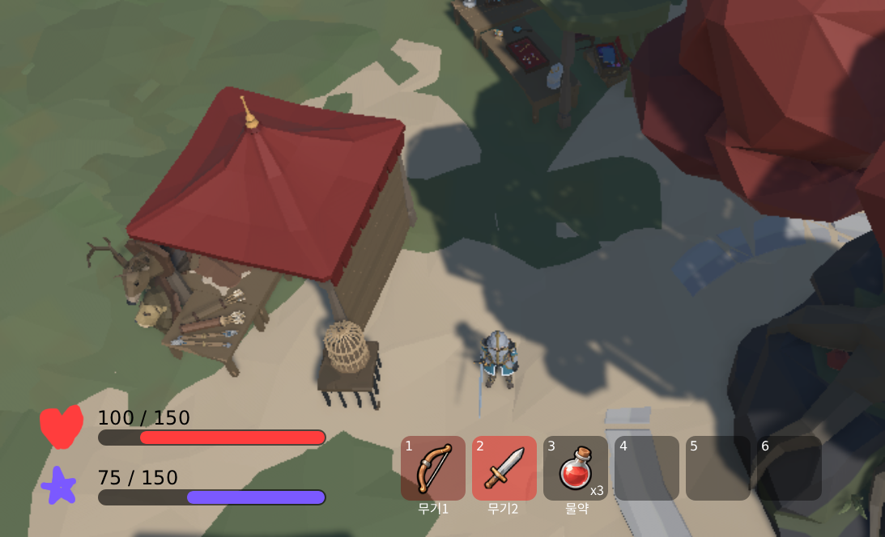

# 하단 HUD · 퀵바

## 시안

원본 PSD: [`images/quickbar-mockup.psd`](images/quickbar-mockup.psd)

## 구성

- 왼쪽 아래: 하트 아이콘 + HP 바, 별 아이콘 + 마나 바. 수치 텍스트는 흰색 `현재 / 최대`
- 하트·별은 `HudArtwork`의 `Heart`, `Star` 도형으로 코드에서 그립니다(이미지 에셋 없음).
- 퀵바 6칸, 키 1~6. 칸 아래 이름(무기1/무기2/등록 아이템 이름), 오른쪽 아래 수량

## 등록 규칙 (`PlayerQuickSlots.Accepts`)

| 칸 | 받는 아이템 | 배경 |
| --- | --- | --- |
| 1~2 | 무기(`EquipmentType.Weapon`: 검·활·지팡이) | 붉은 배경, 손에 든 무기 칸은 진한 빨강 + 붉은 테두리 빛 |
| 3~6 | 전투 중 사용 가능한 소모품(현재 회복약) | 회색 배경 |

- 규칙에 맞지 않는 칸으로의 등록·이동·교환은 거부되고, 드래그 중에도 강조되지 않습니다.
- 새 소모품을 추가하면 `PlayerQuickSlots.IsCombatConsumable`과 `TryUse`에 함께 추가합니다.
